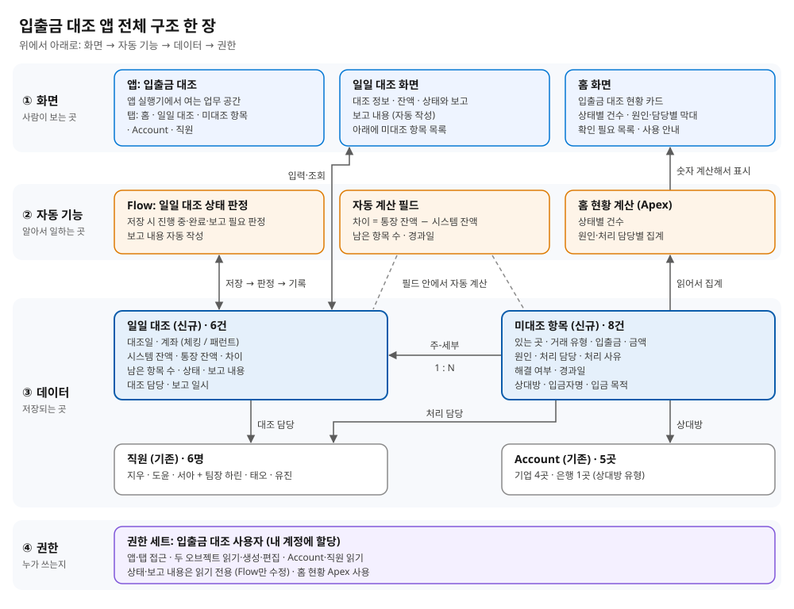
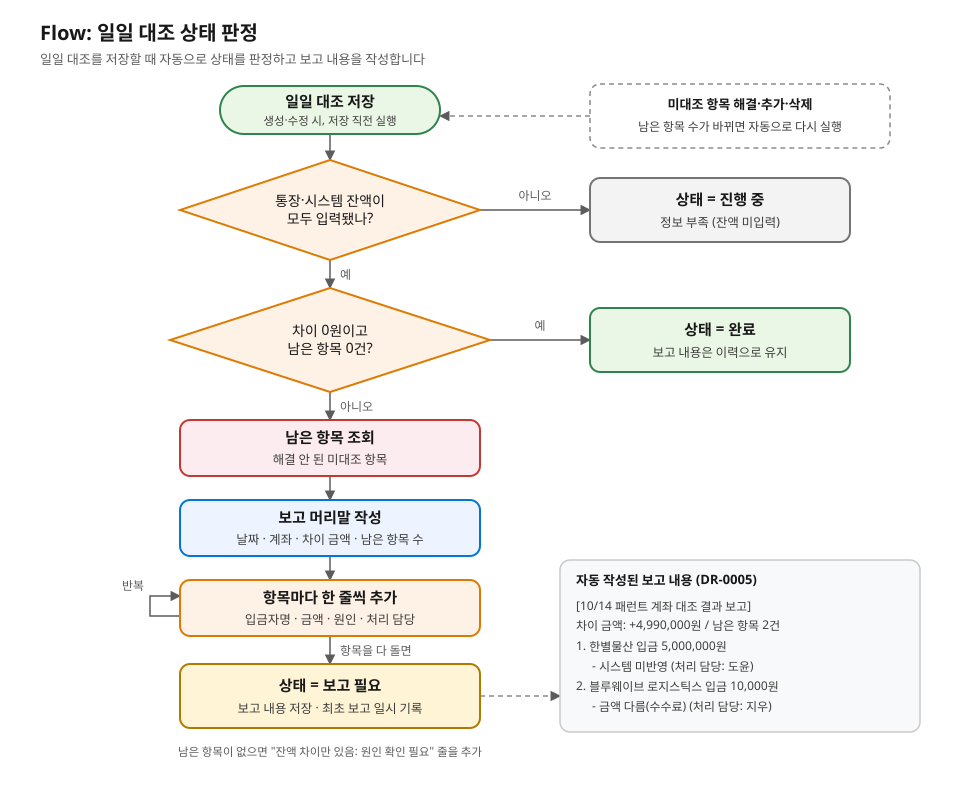

# 은행 운영팀의 입출금 내역 대조 관리 앱

[English](README-bank-recon.md) · **한국어**

> Salesforce101 Day3 미니 프로젝트 · 은행, 고객사, 인물, 금액은 모두 가상 데이터입니다.

## 앱 목적

**은행 운영팀 직원**이 사용하는 앱이며, **하루치 시스템 잔액과 통장 잔액의 대조**를 처리하고, **차이가 0원이 됐는지 또는 보고가 필요한지** 확인합니다.

외국계 은행 운영팀에서는 엑셀로 짝을 맞춘 뒤, 프린트한 시스템 내역에서 남은 금액을 손으로 지우고, 잔액 차이가 0원이 아니면 모든 부서에 통합 메일로 보고했습니다. 이 앱은 짝 맞추기는 엑셀에 그대로 두고, **남은 항목과 잔액 차이, 보고 기록**을 Salesforce로 옮깁니다.

### 왜 차이가 0원이어야 하나요?

통장에 있는 돈과 은행 시스템 장부가 같아야, 모든 고객 돈이 장부에 기록됐다는 증명이 되기 때문입니다.

가장 흔한 불일치인 **시스템 미반영**은 돈은 은행 통장(패런트)에 들어왔는데, 은행 시스템 장부에 그 고객 몫으로 아직 기록되지 않은 상태입니다. 실습한 DR-0007이 그 예입니다.

| 단계 | 통장 잔액 | 시스템 잔액 | 차이 |
|---|---|---|---|
| 그린셀 바이오 30만 원 입금, 시스템 미반영 | 100,300,000원 | 100,000,000원 | +300,000원 |
| 재무팀 도윤이 시스템에 30만 원 입력 | 100,300,000원 | 100,300,000원 | 0원 |

시스템 미반영이 남아 있으면 장부상 그린셀 바이오의 잔액이 30만 원 적게 잡혀, 고객이 조회해도 입금이 보이지 않습니다. 작은 차이도 큰 실수 두 개가 서로 상쇄된 결과일 수 있어, 한 줄씩 원인을 밝혀 0원을 만듭니다.

## 구성



| 구분 | 이름 (API) | 역할 |
|---|---|---|
| 앱 | 입출금 대조 (`Bank_Recon`) | 탭: 홈 · 일일 대조 · 미대조 항목 · Account · 직원 |
| 홈 화면 | 입출금 대조 홈 (`Bank_Recon_Home`) | 현황 카드(LWC `reconDashboard`) + 리포트 차트 2개(상태별 비율, 날짜별 남은 항목 수) + 사용 안내 |
| 리포트 | 폴더 "입출금 대조 리포트": 일일 대조 상태별 (`Daily_Recon_By_Status`), 날짜별 남은 항목 수 (`Open_Items_By_Date`) | 홈 차트의 원본. 차트를 누르면 리포트가 열림 |
| 신규 오브젝트 | 일일 대조 (`Daily_Recon__c`) | 하루 × 계좌 1개 = 1건. 시스템 잔액, 통장 잔액, 차이(수식), 남은 항목 수(롤업), 상태, 보고 내용, 긴급도(수식: 남은 항목 중 지급 대행 자금이 있거나 3일 이상 지나면 🔴) |
| 신규 오브젝트 | 미대조 항목 (`Recon_Item__c`) | 프린트에서 안 지워진 금액 1건. 일일 대조와 주-세부 관계. 거래 유형, 입금 목적, 원인, 처리 담당, 해결 여부, 경과일(수식), 긴급도(수식: 🔴 긴급 = 미해결이면서 지급 대행 자금이거나 경과일 3일 이상 / 🟡 보통 / 🟢 해결) |
| 기존 오브젝트 | Account | 상대방 기업·은행 (`Counterparty_Type__c`: 기업 / 은행) |
| 기존 오브젝트 | 직원 (`Employee__c`) | 대조 담당, 처리 담당, 팀장(상위 직원). 주제 목록에 "금융" 추가 |
| 보고 대상 (수식) | `Report_Manager__c`, `Report_Department__c` | 일일 대조·미대조 항목마다 담당자의 팀장과 부서를 자동 표시 |
| 자동화 | Flow: 일일 대조 상태 판정 (`Daily_Recon_Status`) | 저장할 때 상태 판정 + 보고 내용 자동 작성 |
| 입력 화면 | 스크린 Flow: 대조 입력 마법사 (`Recon_Entry_Wizard`) | 새 대조 만들기 또는 진행 중인 대조 이어서 하기 → 잔액 → 안 맞는 금액 등록 → 결과 (홈 오른쪽, 운영팀만 보임) |
| 권한 | 권한 세트: 입출금 대조 사용자 (`Bank_Recon_User`) | 두 오브젝트 읽기·생성·편집(삭제 불가), Account·직원 읽기, 앱·탭·마법사 접근. 자세한 내용은 아래 "사용자와 권한" |

계좌는 두 가지입니다: **체킹 (은행 운영 계좌)**: 선물 거래, 자체 입출금, 지로 · **패런트 (기업 고객 모계좌)**: 기업·타 은행 입출금.

### Flow 판정 규칙

| 조건 | 상태 | 함께 일어나는 일 |
|---|---|---|
| 통장 잔액 또는 시스템 잔액이 비어 있음 | 진행 중 | 정보 부족 사례 |
| 차이 0원, 남은 항목 0건 | 완료 | 이전 보고 내용은 이력으로 유지 |
| 그 밖의 경우 | 보고 필요 | 보고 내용 자동 작성 (보고 대상 팀장, 항목별 "→ 보고: 재무팀장 태오" 포함), 최초 보고 일시 기록 |

미대조 항목을 해결·추가·삭제하면 남은 항목 수(롤업)가 바뀌면서 일일 대조가 자동으로 다시 판정됩니다.

## 실행 순서 (시연)

1. 앱 실행기에서 **입출금 대조** → **일일 대조** 탭 → 리스트 뷰 **확인 필요**
2. **DR-0005** (10/14 패런트) 열기: 차이 +4,990,000원, 남은 항목 2건, 상태 **보고 필요**, 자동 작성된 보고 내용 확인
3. 아래 미대조 항목 **RI-0007** (한별물산 입금 시스템 미반영)에 처리 사유를 쓰고 해결로 체크 → 보고 내용이 1건으로 줄어듦 (처리 사유가 없으면 저장이 막힘)
4. **RI-0008** (수수료 10,000원)도 처리 사유 입력 후 해결 체크 → DR-0005의 시스템 잔액을 **2,244,990,000**으로 정정 → 상태 **완료**

시연을 다시 하려면 **먼저** RI-0007·RI-0008의 해결 체크를 풉니다 (상태가 보고 필요로 돌아감). 그다음 DR-0005 시스템 잔액을 **2,240,000,000**으로 되돌립니다. 완료 상태에서는 잔액을 고칠 수 없기 때문에 순서가 중요합니다.

## 샘플 데이터 위치

| 데이터 | 건수 | 보는 곳 |
|---|---|---|
| 일일 대조 | 7건 (DR-0001~0007) | 일일 대조 탭 → 리스트 뷰 "전체", "확인 필요" |
| 미대조 항목 | 9건 (RI-0001~0009) | 미대조 항목 탭 → "전체", "미해결 항목" (경과일 정렬) |
| 상대방 Account | 5곳 | 한별물산, 블루웨이브 로지스틱스, 그린셀 바이오, 오로라 전자부품, 한강은행 |
| 직원 | 6명 | 지우(대조 담당) → 운영팀장 하린 · 도윤(재무팀 시스템 반영) → 재무팀장 태오 · 서아(기업금융팀) → 기업금융팀장 유진 |

| 일일 대조 | 상황 | 상태 |
|---|---|---|
| DR-0001 · 10/12 체킹 | 모두 맞음 | 완료 |
| DR-0002 · 10/12 패런트 | 입금자명 "(주)한별" ↔ "한별물산" 확인 후 해결 | 완료 |
| DR-0003 · 10/13 체킹 | 지로 입금 시스템 미반영 | 보고 필요 |
| DR-0004 · 10/13 패런트 | 시스템 미반영 2건 + 한강은행 이체 중복 기록 | 보고 필요 |
| DR-0005 · 10/14 패런트 | 한별물산 시스템 미반영 + 블루웨이브 수수료 차감 (시연용) | 보고 필요 |
| DR-0006 · 10/14 체킹 | 통장 잔액 미입력 (정보 부족 사례) | 진행 중 |
| DR-0007 · 10/15 패런트 | 그린셀 바이오 30만 원 시스템 미반영 → 재무팀 반영 후 해결 (실습) | 완료 |

소스 위치: `force-app/main/default/` 아래 `applications/Bank_Recon.app-meta.xml`, `objects/Daily_Recon__c/`, `objects/Recon_Item__c/`, `flows/`, `flexipages/Bank_Recon_Home.flexipage-meta.xml`, `lwc/reconDashboard/`, `classes/`, `permissionsets/`, `roles/`, `sharingRules/`, `reports/`

## 사용자와 권한 (보안)

원칙: **대조 작업은 운영팀만 합니다.** 다른 부서는 앱에 들어오지 않고, 자동 작성된 보고 내용을 메일로 받아 자기 시스템에서 처리한 뒤 운영팀에 알립니다. 실제 업무 방식(통합 메일 보고 → 운영팀 확인)과 같습니다.

### 부서별 접근

```
지점장
├─ 운영팀장 (하린) ─ 운영팀 (지우)          ← 접근 가능 (공개 그룹 "입출금 대조 접근 부서")
├─ 재무팀장 (태오) ─ 재무팀 (도윤)          ┐
├─ 기업금융팀장 (유진) ─ 기업금융팀 (서아)  │
├─ IT팀 (준호)                              ├ 접근 없음 (보고 메일만 받음)
├─ 인사팀 HR (소연)                         │
└─ TF팀 (현우)                              ┘
```

| 부서 | 볼 수 있는 대조 (전체 7건 기준) | 앱·리포트 |
|---|---|---|
| 운영팀 (하린, 지우) | 7건 | 보임 |
| 재무팀, 기업금융팀, IT팀, 인사팀, TF팀 | **0건** | 안 보임 |

두 겹으로 막습니다.
1. **권한 세트 = 무엇을 할 수 있나**: 앱 권한 세트 "입출금 대조 사용자"는 운영팀(지우, 하린)과 본인에게만 있습니다.
2. **공유 = 어떤 기록을 볼 수 있나**: 일일 대조의 기본 공개 범위(OWD)를 **비공개**로 하고, 공유 규칙 **"운영팀에 공유"**로 운영팀 그룹에만 엽니다. 미대조 항목은 일일 대조를 따라갑니다. 리포트 폴더도 이 그룹만 볼 수 있습니다.

그래서 실수로 다른 부서에 권한 세트를 줘도 기록은 0건으로 보입니다.

### 사용자

| 사용자 | 직책 | 프로필 | 권한 세트 | 할 수 있는 것 |
|---|---|---|---|---|
| 본인 | 주 관리자 | 시스템 관리자 | 입출금 대조 사용자 | 전부 |
| 하린 | 운영팀장 (백업 관리자) | 시스템 관리자 | 입출금 대조 사용자 | 전부 |
| 지우 | 운영팀 대조 담당 | 표준 플랫폼 사용자 | 입출금 대조 사용자 | 대조·항목 만들기, 잔액 입력, 해결 체크, 마법사 (삭제 불가) |
| 도윤, 서아, 태오, 유진 | 처리 담당 / 팀장 | 표준 플랫폼 사용자 | 없음 | 접근 없음. RI의 처리 담당·보고 대상으로 **이름만 기록됨** |
| 준호, 소연, 현우 | IT·HR·TF | Force.com - Free User | 없음 | 접근 없음 |

- **삭제 금지**: 대조 기록은 감사 증거라서 관리자만 지울 수 있습니다.
- **마법사 표시 제한**: 홈의 대조 입력 마법사는 커스텀 권한 `대조 입력`(Recon_Entry)이 있는 사람에게만 보입니다.
- 권한 세트 "입출금 대조 처리 담당", "입출금 대조 팀장 (조회)"은 지금 아무에게도 주지 않았습니다. 나중에 운영팀 안에서 역할을 더 나눌 때 씁니다.
- **자동 확인**: Apex 테스트 `ReconSecurityTest` 4개가 역할별 수정·삭제 차단, 그리고 재무팀·IT팀은 권한 세트가 있어도 0건으로 보이는지 확인합니다.
- 로그인 사용자의 이메일은 모두 본인 메일이고, 비밀번호 설정 메일은 발송되지 않았습니다.

## 기록 보호 (감사 증거)

대조 기록은 나중에 감사에서 "그날 무엇이 안 맞았고, 누가 어떻게 처리했나"를 보여 주는 증거입니다. 그래서 고친 흔적이 남고, 끝난 기록은 잠기게 했습니다.

**변경 이력**: 아래 칸이 바뀌면 "누가 / 언제 / 이전 값 → 새 값"이 대조·항목 화면 아래 **변경 내역** 목록에 자동으로 남습니다.

| 대상 | 추적하는 칸 |
|---|---|
| 일일 대조 (7개) | 대조일, 계좌, 시스템 잔액, 통장 잔액, 상태, 대조 담당, 보고 일시 |
| 미대조 항목 (11개) | 있는 곳, 금액, 입출금, 거래 유형, 입금 목적, 상대방, 입금자명, 원인, 처리 담당, 처리 사유, 해결 |

**검증 규칙 4개**

| 규칙 | 막는 것 | 이유 |
|---|---|---|
| 처리 사유 필수 | 처리 사유 없이 해결 체크 | 왜 해결됐는지 근거 없이 항목이 사라지는 것 방지 |
| 완료 대조 잠금 | 완료된 대조의 대조일·계좌·잔액 수정 | 끝난 대조의 숫자를 나중에 바꾸는 것 방지 |
| 완료 대조 항목 추가 금지 | 완료된 대조에 새 항목 추가 | 끝난 날의 결과가 몰래 바뀌는 것 방지 |
| 해결 항목 잠금 | 해결된 항목의 금액·있는 곳·입출금 수정 | 해결 체크를 먼저 풀어야 고칠 수 있음 → 푼 기록이 이력에 남음 |

- **예외 권한** `대조 수정 예외`(Recon_Override): 이 권한이 있으면 위 규칙을 넘을 수 있습니다. 평소에는 **아무에게도 주지 않습니다.** 꼭 고쳐야 할 때만 관리자가 잠시 주고, 고친 내용은 변경 이력에 남습니다.
- **자동 확인**: Apex 테스트 `ReconRecordProtectionTest` 5개가 규칙과 변경 이력 사용을 확인합니다.

## 남은 문제와 다음 개선

- 짝 맞추기는 지금처럼 엑셀에서 합니다. 앱에는 남은 항목만 입력합니다.
- 보고 메일은 실제로 보내지 않고, 보고 내용을 레코드에 남깁니다.
- 항목의 원인이나 처리 담당만 고치면 보고 내용이 바로 바뀌지 않습니다. 일일 대조를 한 번 저장하면 갱신됩니다.
- 잔액만 고쳐서 차이를 0원으로 만든 뒤 항목을 해결 체크하면 완료될 수 있습니다. 잔액 수정 사유 필수, 남은 항목 합계와 차이 비교 같은 검증이 필요합니다.
- 다음 개선: 엑셀 결과 CSV 가져오기, 같은 날짜·금액 거래 자동 짝 맞추기, 긴급 건 알림과 실제 메일 발송, 같은 날·같은 계좌 중복 방지

## 핵심 화면 캡처

화면 캡처(1~4)는 준비 중입니다. 지금은 흐름도 이미지만 들어 있습니다.

| # | 화면 | 파일 |
|---|---|---|
| 1 | 일일 대조 리스트 뷰 "확인 필요" | `docs/screens/01-list-needs-report.png` |
| 2 | DR-0005 상세: 보고 필요 + 보고 내용 + 미대조 항목 목록 | `docs/screens/02-dr0005-report.png` |
| 3 | RI-0007 해결 체크 | `docs/screens/03-ri0007-resolved.png` |
| 4 | DR-0005 완료 | `docs/screens/04-dr0005-done.png` |
| 5 | Flow 흐름도: 일일 대조 상태 판정 | `docs/screens/05-flow-daily-recon-status.svg` |


